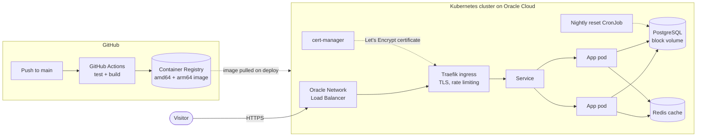

# User Service

[](https://github.com/Yuritiu/Java-Microservice/actions/workflows/ci.yml)

A Spring Boot REST microservice for managing users, backed by PostgreSQL and
Redis, running on Kubernetes in Oracle Cloud.

**Live demo: [ben-user-service.duckdns.org](https://ben-user-service.duckdns.org)**

The demo opens on an interactive API page (Swagger UI). Pick any endpoint, press
**Try it out** and send a real request. You can create, edit and delete users.
The data resets every night at 03:00 UK time, so feel free to experiment.

## Architecture



A request comes in over HTTPS to Oracle's load balancer and reaches Traefik,
which handles the certificate, redirects plain HTTP to HTTPS and rate-limits
each visitor. Traefik passes it to one of two app pods. Lookups by id are cached
in Redis for 10 minutes, everything else goes to PostgreSQL, whose data lives on
an Oracle block volume that survives pod and node restarts.

## Tech stack

| Area | Technology |
|---|---|
| Language and framework | Java 17, Spring Boot 3 (Web, Data JPA, Validation, Actuator) |
| Data | PostgreSQL 15, Redis 8 (Spring Cache) |
| API docs | springdoc-openapi (Swagger UI), generated from the controllers |
| Tests | Spock (Groovy), MockMvc |
| Containers | Docker multi-stage build, multi-architecture (amd64 and arm64) |
| Orchestration | Kubernetes, Kustomize overlays, Helm |
| Ingress and TLS | Traefik, cert-manager, Let's Encrypt |
| CI | GitHub Actions, GitHub Container Registry |
| Hosting | Oracle Cloud Kubernetes Engine (OKE), Always Free ARM node |

## API

| Method | Path | Description |
|---|---|---|
| `GET` | `/api/users` | List all users |
| `GET` | `/api/users/{id}` | Get one user (cached in Redis) |
| `POST` | `/api/users` | Create a user |
| `PUT` | `/api/users/{id}` | Update a user's name and email |
| `DELETE` | `/api/users/{id}` | Delete a user |

```bash
curl -X POST https://ben-user-service.duckdns.org/api/users \
  -H 'Content-Type: application/json' \
  -d '{"name":"Ada Lovelace","email":"ada.l@example.com"}'
```

Errors come back as consistent [RFC 7807](https://www.rfc-editor.org/rfc/rfc7807)
problem details, for example:

```json
{"status":409,"title":"Email already in use","detail":"A user with email ada.l@example.com already exists"}
```

| Status | When |
|---|---|
| `400` | Invalid input, with a message for each field |
| `404` | No user with that id |
| `409` | Email already in use |
| `429` | Rate limit hit, or the demo is full (100 users) |

## Highlights

- **Kubernetes probes done properly.** A startup probe gives the JVM time to
  boot. Liveness ignores the database so a database blip doesn't restart every
  pod, while readiness checks PostgreSQL and Redis so traffic only reaches pods
  that can serve it.
- **Rolling updates with no downtime.** New pods must pass readiness before old
  ones are removed.
- **One set of manifests, two environments.** A shared Kustomize base, with small
  overlays for local minikube and Oracle Cloud.
- **Every deploy is traceable.** Images are tagged with the commit they were
  built from, and the deploy script refuses to deploy a commit CI hasn't built.
- **Built for a public demo.** Per-visitor rate limiting, a request size limit,
  a cap on stored users, a nightly data reset, and health endpoints that don't
  reveal internal details.
- **Secrets stay out of git.** The database password is generated at deploy time
  and only ever stored in a Kubernetes Secret.
- **Fast ARM builds.** The Maven stage of the Dockerfile always runs natively,
  so building the arm64 image on GitHub's x86 runners doesn't run Maven under
  emulation.

## Run it locally

**Quickest: Docker Compose** (needs Docker):

```bash
docker compose up --build
```

Then open <http://localhost:8080>.

**On Kubernetes with minikube** (needs Docker, kubectl, minikube and Helm):

```bash
./deploy-minikube.sh
```

The script starts minikube, installs Traefik, builds the image into the cluster
and prints the URL. Details are in [kubernetes/README.md](kubernetes/README.md).

**Tests** (no database needed, runs Maven in a throwaway container):

```bash
docker run --rm -v "$PWD":/app -v m2cache:/root/.m2 -w /app \
  maven:3.9-eclipse-temurin-17 mvn -B test
```

## Deployment pipeline

1. Every push and pull request to `main` runs the tests on GitHub Actions.
2. On `main`, a passing build produces an image for amd64 and arm64, pushed to
   `ghcr.io/yuritiu/java-microservice:sha-<commit>`.
3. `./deploy-oracle.sh` deploys the image for the current commit to Oracle Cloud,
   installing Traefik, the load balancer and cert-manager where needed, then
   waits for the rollout and the HTTPS certificate.

## Project structure

```
├── src/main/java/...          Spring Boot application
├── src/test/groovy/...        Spock tests
├── Dockerfile                 multi-stage, multi-architecture build
├── docker-compose.yml         local run with PostgreSQL and Redis
├── kubernetes/
│   ├── base/                  manifests shared by every environment
│   ├── overlays/minikube/     local cluster
│   ├── overlays/oracle/       Oracle Cloud: registry image, block storage, HTTPS
│   ├── traefik/               Helm values for the ingress controller
│   └── cert-manager/          Let's Encrypt issuer
├── deploy-minikube.sh
├── deploy-oracle.sh
└── .github/workflows/ci.yml   tests, image build and push
```

## Lessons from getting it live

- **ingress-nginx was retired in March 2026**, so the cluster uses Traefik
  instead. An ingress controller facing the internet needs security fixes.
- **Oracle's nodes run CRI-O**, which rejects short image names like
  `postgres:15` as ambiguous. Manifests use full names such as
  `docker.io/library/postgres:15`.
- **Oracle's load balancer reports a private and a public IP.** The deploy
  script picks the public one for the DNS check.
- **Free ARM capacity is limited.** The second node hit "Out of host capacity",
  so CPU requests were tuned to fit the whole stack on one 1-OCPU node.

## Possible next steps

- Database migrations with Flyway instead of Hibernate's automatic schema updates
- Continuous deployment from GitHub Actions instead of a local script
- Metrics and dashboards with Prometheus and Grafana
- Authentication on write endpoints
- Moving from Ingress to the Kubernetes Gateway API

## Author

Ben Findlay. [Portfolio](https://ben-findlay-portfolio.netlify.app) · [GitHub](https://github.com/Yuritiu)
